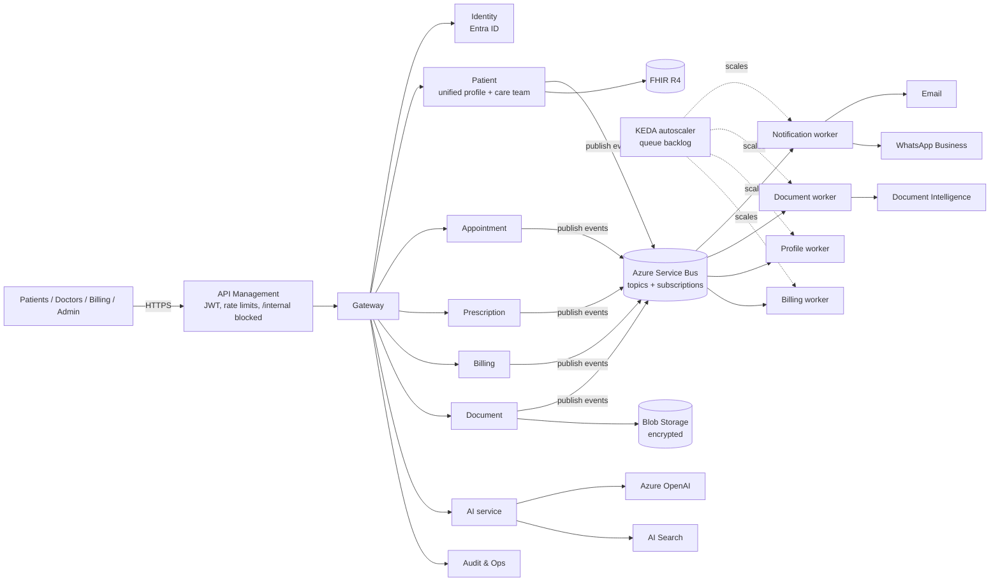

# MediFlow AI

**Secure, scalable, AI-powered hospital automation platform** - Azure-native microservices,
event-driven architecture, generative-AI assistance and security-first design.

Every patient gets a unique, check-digit-validated ID (`MF-1234-5678-9`) that links their medical
history, appointments, prescriptions, lab reports, bills and consultations in one longitudinal
record. AI makes that record easier to read; Service Bus + autoscaled workers keep the platform
responsive under load.

**Live demo (Azure App Service, Free tier):** https://mediflow-ai-458ce0.azurewebsites.net -
patient login `asha` / `MediFlow#2026`. (The free tier sleeps when idle, so the first load can take ~30-60 s.)

| Document | What's inside |
|---|---|
| [docs/PROJECT_OVERVIEW.md](docs/PROJECT_OVERVIEW.md) | Full project details: problem, roles, modules, architecture, Azure services, security, testing, interview talking points |
| [docs/DEPLOYMENT.md](docs/DEPLOYMENT.md) | Live Azure resources, settings, and how every component connects (demo + production) |
| [docs/DEMO_GUIDE.md](docs/DEMO_GUIDE.md) | Demo accounts and a 5-minute guided tour of the live site |
| [docs/API.md](docs/API.md) | All 79 API endpoints by service |
| [docs/SECURITY.md](docs/SECURITY.md) | STRIDE threat model and controls |

> **Runs entirely locally at zero cost.** Every Azure dependency has a free local stand-in behind
> the same interface, switched by one environment variable. The Azure production architecture is
> fully written as Bicep (`infra/`), validated by compilation, and **not deployed**.
> All demo data is synthetic.

---

## Quick start

```powershell
cd mediflow-ai
python -m venv .venv
.\.venv\Scripts\pip install -r requirements.txt
.\.venv\Scripts\python run_local.py --seed
```

Open **http://127.0.0.1:8000**. Demo accounts are printed and saved to `data/demo_credentials.txt`:

| Login | Role | Notes |
|---|---|---|
| `asha` / `MediFlow#2026` | patient | Hindi-speaking, diabetic, WhatsApp on |
| `ravi` / `MediFlow#2026` | patient | Telugu-speaking |
| `dr.khan`, `dr.rao`, `dr.iyer` / `MediFlow#2026` | doctor | needs MFA code |
| `billing.desk` / `MediFlow#2026` | billing | needs MFA code |
| `admin` / *(in credentials file)* | admin | needs MFA code |

Staff MFA code (acts as your authenticator app): `.\.venv\Scripts\python scripts\totp.py dr.khan`

```powershell
.\.venv\Scripts\python -m pytest -q             # 20 tests: security, flows, bus semantics
.\.venv\Scripts\python scripts\load_test.py 5000 # burst test - watch the autoscaler in run_local output
az bicep build --file infra\main.bicep           # validate Azure IaC (local, no cost)
```

Emails and WhatsApp messages the platform "sends" are written to `data/outbox/` so you can read them.

---

## Architecture



**Synchronous vs asynchronous paths.** User requests (book, pay, upload) are handled synchronously
only for validation and the primary write, then return. Slow or fan-out work - receipts,
WhatsApp, document extraction, timeline updates, invoice generation - is published to Service
Bus and handled by workers. Service Bus is a durable buffer, **not** a load balancer: HTTP traffic
goes through API Management / the gateway, and each API scales on HTTP concurrency while each
worker scales on its own queue backlog.

### Azure service mapping (local stand-in → production)

| Capability | Local (free, default) | Azure (in `infra/`) |
|---|---|---|
| Compute + autoscale | One process per service, KEDA-style scaler in `run_local.py` | Container Apps; HTTP rules for APIs, `azure-servicebus` KEDA rules for workers (scale to 0) |
| Messaging | SQLite emulator with topics, peek-lock, retries, DLQ, duplicate detection | Service Bus Standard, managed-identity auth, local keys disabled |
| API gateway | `gateway` service: routing, rate limits, `/internal` blocking | API Management Consumption + policies |
| Identity & MFA | `identity` service: PBKDF2, TOTP MFA, lockout, JWT | Microsoft Entra ID (`MEDIFLOW_AUTH_MODE=entra` validates Entra JWTs via JWKS) |
| Clinical summaries & chat | Deterministic grounded engines | Azure OpenAI (`gpt-4o-mini`) - **flag off by default (paid)** |
| Document extraction | Rule-based lab/medication/field parser (txt, text PDFs) | Document Intelligence `prebuilt-layout` (F0 free tier) |
| Knowledge retrieval (RAG) | BM25 index over trilingual KB | Azure AI Search (Free tier) |
| Clinical data standard | FHIR R4 `Patient` / `MedicationRequest` endpoints | Health Data Services FHIR - **flag off (paid)** |
| Relational data | SQLite per service | Azure SQL serverless, free offer, Entra-only auth |
| Files | AES-256-GCM encrypted local blobs | Blob Storage, no public/shared-key access, versioning, WORM audit archive |
| Secrets | Generated per install in `data/` | Key Vault (RBAC, purge protection) via managed identity |
| Telemetry | JSON logs with correlation ids in `data/logs/` | Application Insights + Log Analytics + alert rules |

---

## Modules

1. **Unified Patient Profile** - random, non-enumerable IDs with a Luhn check digit; one timeline
   assembled from every service's events; diet plans; FHIR export.
2. **AI medical-history summarization** - uploaded reports → extraction (lab values with
   reference ranges, high/low flags) → a sectioned summary in which **every bullet cites its source
   record**. Uncited statements are dropped by a grounding validator. Summaries are drafts until a
   doctor approves them; the AI never diagnoses.
3. **Digital prescriptions & refills** - every change (create/update/renew/discontinue) is a new
   immutable version that requires MFA-verified prescriber approval; allergy conflicts must be
   acknowledged; refill eligibility (active, unexpired, refills left, none pending); patients can
   read and request refills, never modify.
4. **Smart scheduling** - availability windows → slots; double-booking blocked by a filtered
   unique index (correct under concurrency across replicas); patient clash detection; completion,
   cancellation, no-show; reminders via a scheduled job (Azure Functions timer equivalent).
5. **Automated billing & notifications** - appointment events raise invoices; payments need an
   `Idempotency-Key`; success is accepted only from an HMAC-verified gateway callback; replays are
   no-ops; `payment.succeeded` → email receipt + WhatsApp (opt-in only) with per-channel
   delivery/retry status.
6. **Multilingual assistant** (English, Hindi, Telugu) - hospital FAQs via retrieval; personal
   questions ("my bills", "मेरा अपॉइंटमेंट", "నా బిల్లులు") require login and fetch only the
   caller's data with the caller's own token; emergency escalation (108); refuses diagnosis.

## Reliability under load

The `5,000 patients at once` scenario: `scripts/load_test.py` publishes a burst of events; the
autoscaler raises notification workers from 1 to 5 replicas and back down as the backlog drains.
Guarantees, all covered by tests:

* **At-least-once + idempotent consumers** - an inbox table per worker skips already-processed messages.
* **Duplicate detection** - deterministic message ids (`payment.succeeded:<payment-id>`) dropped within a 10-minute window.
* **Peek-lock** - a crashed/terminated worker's messages are redelivered when the lock expires.
* **Retries with exponential backoff → dead-letter queue** after 5 attempts; admins can inspect and resubmit from the Operations tab.
* **Per-channel delivery state** - a retry after a WhatsApp failure doesn't resend the email.

## Security

See [docs/SECURITY.md](docs/SECURITY.md) for the threat model. Highlights:

| Control | Implementation |
|---|---|
| RBAC + record-level access | Role permissions **and** care-team check per request: doctors only see patients they treat; billing sees payments, never diagnoses |
| Zero trust between services | Every service validates the JWT itself; `/internal/*` needs a service identity and is blocked at the gateway |
| Strong authentication | MFA for privileged roles; lockout after 5 failures; generic errors (no user enumeration) |
| Break-glass | Time-boxed (4 h) emergency access with mandatory justification → critical audit event + alert |
| Tamper-evident audit | Hash-chained log of every read/write of patient data; `/audit/verify` detects edits; patients can see who accessed their record |
| Encryption | TLS in transit; AES-256-GCM locally / SSE + infrastructure encryption in Azure; SQL TDE |
| Upload hardening | Size limit, magic-byte type check (not client Content-Type), server-generated names, SHA-256 integrity check on download |
| API protection | Rate limits (stricter on login), body-size limits, pydantic validation, control-char stripping, CSP and security headers |
| Payment integrity | Idempotency keys, HMAC-signed webhooks (constant-time compare), forged callbacks raise an alert |
| AI safety | Token-scoped retrieval, prompt-injection screening, cross-patient ID blocking, grounding validator, human approval, no diagnosis |
| Detection | Alerts for brute force, password spraying, insider probing (repeated denials), break-glass, AI abuse, forged webhooks |

## Project layout

```
mediflow/common/      auth, bus, audit, storage, AI, extraction, search, FHIR, security
mediflow/services/    identity, patient, appointment, prescription, billing, document, ai, audit, gateway
mediflow/workers/     notification, document, profile, billing workers + reminder job
frontend/             role-based web portal (patient / doctor / billing / admin)
infra/                Bicep: Container Apps + KEDA, Service Bus, APIM, Key Vault, SQL, Storage, AI, FHIR, monitoring
tests/                unit + end-to-end security and workflow tests
scripts/              seed (synthetic data), load test, TOTP helper
```

## Deploying to Azure

The free demo runs in single-container mode on App Service F1. See
[docs/DEPLOYMENT.md](docs/DEPLOYMENT.md) for the resources, settings and wiring.

For the full microservice deployment (only when you choose to):

The templates choose free or consumption tiers by default, and paid AI services are off
(`deployAiServices=false`, `deployFhir=false`). Some resources still bill a little (e.g. Service
Bus Standard, Log Analytics ingestion). Preview first:

```powershell
az group create -n rg-mediflow -l centralindia
az deployment group what-if -g rg-mediflow -f infra/main.bicep   # shows changes, deploys nothing
```

## Disclaimer

Portfolio project using synthetic data. A real deployment would additionally need privacy,
consent and retention design, clinical-safety review and the applicable regulatory approvals
(e.g. India's DPDP Act and ABDM guidelines, or HIPAA in the US).
