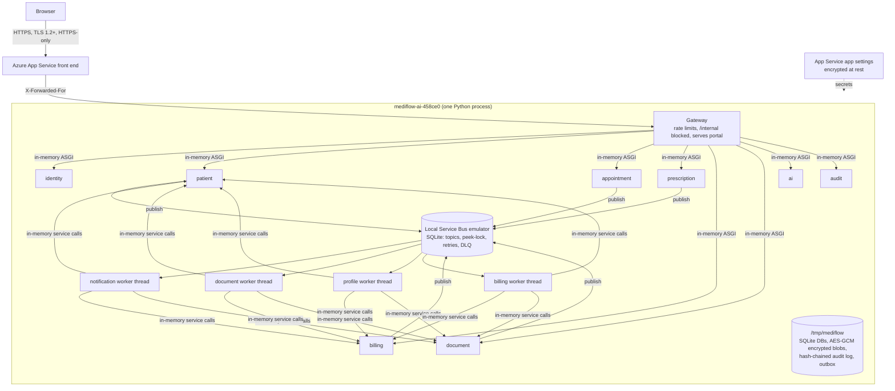
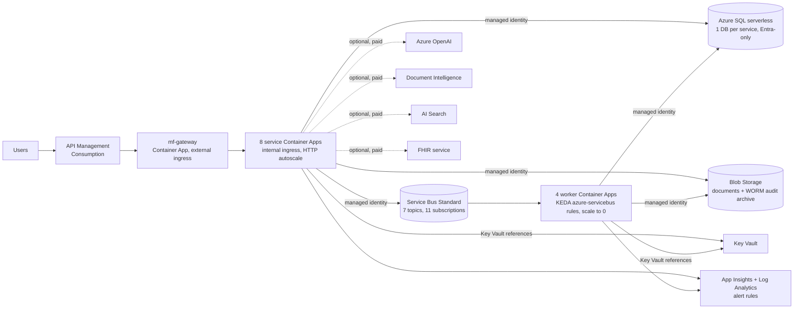

# MediFlow AI - Azure deployment & how everything connects

## Live demo (free tier)

**https://mediflow-ai-458ce0.azurewebsites.net**

| | |
|---|---|
| Subscription | Azure for Students |
| Resource group | `rg-mediflow-demo` (Korea Central - one of the subscription's allowed regions) |
| Monthly cost | **$0** - only Free-tier resources are deployed |

### Deployed Azure resources

| Resource | Type | SKU | Purpose |
|---|---|---|---|
| `mediflow-free-plan` | App Service plan (Linux) | **F1 Free** | Compute for the demo |
| `mediflow-ai-458ce0` | App Service web app (Python 3.12) | runs on F1 | Hosts the whole platform in single-container mode |

Nothing else is deployed: no Service Bus, SQL, Storage, OpenAI or Log Analytics, so nothing
can generate a bill. Those production components are defined in `infra/` (Bicep) and are
deployed only if you choose to (see [Production architecture](#production-architecture-infra)).

### How the free demo is wired

The F1 tier runs one app, so the demo uses **single-container mode**
(`mediflow/allinone.py`). The code, APIs and security model are exactly the same as the
microservice deployment; only the transport between components changes:



| Concern | Microservice deployment | Free demo |
|---|---|---|
| Gateway → services | HTTP over the Container Apps internal network | In-memory ASGI calls |
| Service → service | HTTP + service JWT | In-memory client, same service JWT checks |
| Events | Azure Service Bus topics | SQLite emulator with the same semantics |
| Workers | Separate Container Apps scaled by KEDA | Background threads |
| Reminders | Azure Functions timer | Background thread every 5 minutes |
| Secrets | Key Vault references via managed identity | App Service app settings (encrypted at rest) |
| Data | Azure SQL, Blob Storage | Local SQLite + encrypted files in `/tmp/mediflow` |

### App settings (configuration)

| Setting | Value / purpose |
|---|---|
| `SCM_DO_BUILD_DURING_DEPLOYMENT` | `true` - Oryx installs `requirements.txt` at deploy time |
| `MEDIFLOW_DATA_DIR` | `/tmp/mediflow` (local disk; SQLite WAL isn't safe on the SMB-backed `/home`) |
| `MEDIFLOW_TRUST_PROXY` | `1` - rate limits key on the real client IP from `X-Forwarded-For` |
| `MEDIFLOW_JWT_SECRET`, `MEDIFLOW_PAYMENT_WEBHOOK_SECRET` | random secrets, set only in Azure |
| `MEDIFLOW_BOOTSTRAP_ADMIN_PASSWORD`, `MEDIFLOW_DEMO_MFA_SECRET` | demo admin password + shared demo MFA secret, set only in Azure (never in this repo) |

Startup command:
`python -m uvicorn mediflow.allinone:create_app --factory --host 0.0.0.0 --port 8000`

Hardening: HTTPS-only, minimum TLS 1.2, FTP/FTPS disabled, security headers + CSP from the app.

### Demo behaviour & limits

* **Synthetic data is re-created on every restart.** `/tmp` is wiped when the app restarts, and
  the seeder runs automatically, so patient IDs change after a restart.
* The F1 tier sleeps after ~20 minutes idle, so the first request after that takes ~30-60 s.
  It also allows 60 CPU-minutes/day; worker threads back off when idle to save quota.
* Patient demo logins (`asha`, `ravi`, `neha` / `MediFlow#2026`) are intentionally public.
  Staff accounts (`dr.khan`, `dr.rao`, `dr.iyer`, `billing.desk`, `admin`) also need an MFA code
  from the demo MFA secret, which the owner keeps privately in an authenticator app.

### Redeploying

```powershell
# from mediflow-ai/: zip mediflow/, frontend/, scripts/, requirements.txt, then
az webapp deployment source config-zip -n mediflow-ai-458ce0 -g rg-mediflow-demo --src mediflow-deploy.zip
```

### Removing everything

```powershell
az group delete -n rg-mediflow-demo --yes
```

---

## Production architecture (`infra/`)

`infra/main.bicep` describes the full microservice deployment. It compiles locally
(`az bicep build --file infra/main.bicep`) and has **not** been deployed.



| Module | Resources | How it connects |
|---|---|---|
| `main.bicep` | User-assigned managed identity | One identity for all apps; every data-plane role below is granted to it (no connection strings or keys) |
| `monitoring.bicep` | Log Analytics (1 GB/day cap), Application Insights, 2 scheduled alert rules | Apps send traces via `APPLICATIONINSIGHTS_CONNECTION_STRING`; alerts on brute force and break-glass |
| `keyvault.bicep` | Key Vault (RBAC, purge protection) | Container Apps load `jwt-secret` and `payment-webhook-secret` as Key Vault secret references (Key Vault Secrets User role) |
| `servicebus.bicep` | Namespace (local auth disabled), topics with duplicate detection, subscriptions (max delivery 5, 30 s lock) | Services publish and workers consume with the Azure Service Bus Data Owner role; the topology mirrors `mediflow/common/bus.py` |
| `storage.bicep` | StorageV2, no public or shared-key access, `medical-documents` + immutable `audit-archive` | Storage Blob Data Contributor role |
| `sql.bicep` | SQL server (Entra-only admin), serverless DB per service on the free offer, TDE | Services connect passwordlessly via `ActiveDirectoryMsi` ODBC connection strings |
| `containerapps.bicep` | Environment, 8 service apps, gateway, 4 workers | Internal DNS (`http://patient`, ...) for service calls; workers have one KEDA rule per topic subscription |
| `apim.bicep` | API Management Consumption + policy | Fronts the gateway: blocks `/internal`, rate-limits by IP, sets HSTS |
| `ai.bicep` *(flag `deployAiServices`, off)* | Azure OpenAI `gpt-4o-mini`, Document Intelligence F0, AI Search Free | Turns on `MEDIFLOW_AI_MODE=azure` and `MEDIFLOW_EXTRACTION_MODE=azure` |
| `fhir.bicep` *(flag `deployFhir`, off)* | Health Data Services workspace + FHIR R4 | FHIR Data Contributor role |

Preview a production deployment without creating anything:

```powershell
az deployment group what-if -g <rg> -f infra/main.bicep -p location=koreacentral
```
