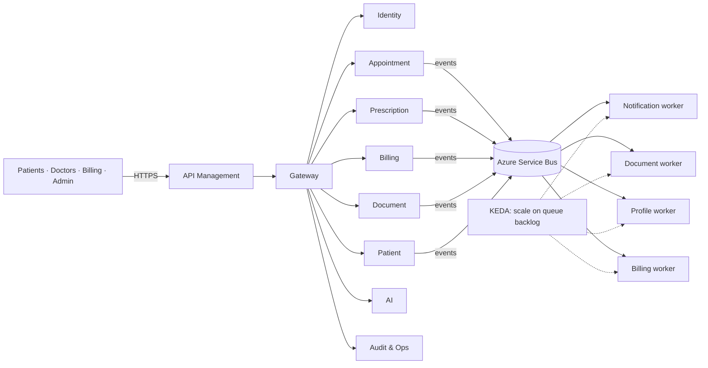

# MediFlow AI - Project overview

**Secure, scalable, AI-powered hospital automation & patient management platform**
Azure Cloud · Generative AI · Microservices · Event-Driven Architecture · Cybersecurity

| | |
|---|---|
| **Live demo** | https://mediflow-ai-458ce0.azurewebsites.net |
| **Source** | https://github.com/Laxmansai4096/mediFlow |
| **Hosting** | Azure App Service, Linux, **F1 Free** tier - resource group `rg-mediflow-demo`, region Korea Central |
| **Cost** | $0 / month |
| **Stack** | Python 3.12, FastAPI, SQLAlchemy, Pydantic, PyJWT, cryptography, vanilla JS portal, Bicep |
| **Size** | 8 microservices + gateway, 4 event workers, 79 API endpoints, 20 automated tests |
| **Data** | 100% synthetic - no real patient information |

Related docs: [README](../README.md) · [Deployment & Azure wiring](DEPLOYMENT.md) ·
[Security & threat model](SECURITY.md) · [API reference](API.md) · [Demo walkthrough](DEMO_GUIDE.md)

---

## 1. The problem and the idea

Hospital records are scattered across paper files, lab portals, billing systems and pharmacy
software. Doctors waste consultation time searching old reports, and patients can't see their
own history in one place.

**MediFlow AI gives every patient one unique ID** (`MF-1234-5678-9`) that links their medical
history, consultations, lab reports, prescriptions, appointments, diet plans and bills. Azure AI
makes that history quick to read, and an event-driven backend (Service Bus + autoscaled workers)
keeps the system responsive when thousands of patients act at once.

## 2. Users and what each can do

| Role | Can | Cannot |
|---|---|---|
| **Patient** | View own profile & timeline, book/cancel appointments, view approved prescriptions, request refills, pay bills, upload reports, chat with the assistant, see who accessed their record | See other patients, change prescriptions |
| **Doctor** | See patients on their care team, read timeline/documents, write consultation notes & diet plans, create/approve prescriptions (MFA), approve refills, generate & approve AI summaries, complete visits, break-glass in emergencies | See patients they don't treat (without audited break-glass) |
| **Billing staff** | See and manage invoices & payments, record cash, view demographics | See diagnoses, notes, documents or prescriptions |
| **Admin** | Manage staff accounts (with MFA enrolment), doctors and availability, register walk-in patients, view audit trail & security alerts, operate the message bus (dead-letter queue) | Read clinical records |

## 3. Modules

### 3.1 Unified Patient Profile (`patient` service)
* Unique ID at registration: random (not sequential, so it can't be enumerated) with a Luhn check digit that catches typing mistakes.
* Longitudinal **timeline** built from events of every other service: registration, appointments, visits, consultations, lab reports (with abnormal values), prescriptions, refills, payments and diet plans.
* **Care team**: booking an appointment automatically gives that doctor access to the patient.
* Field-level views: billing/admin get demographics only.
* **FHIR R4** export (`Patient`, `MedicationRequest`) for standards-based exchange.

### 3.2 AI-powered medical history summarization (`document` + `ai` services)
1. Patient or doctor uploads a report (PDF / text / image, ≤ 5 MB).
2. The document worker extracts structured data: lab tests, values, units, reference ranges and **high/low flags**, medications and key fields (Azure AI Document Intelligence in production; a rule-based extractor in the free build).
3. The doctor clicks **Generate summary**. The AI service collects the timeline, prescriptions, documents and visits - **using the doctor's own token**, so it can never see more than the doctor may.
4. The summary has 6 sections (snapshot, consultations, medications, test results, visits, items for review). **Every statement cites its source record**; a grounding validator removes any statement whose citation doesn't exist.
5. It is a **draft** until the doctor approves it. The AI never diagnoses.

### 3.3 Digital prescriptions & refills (`prescription` service)
* Create, update, renew, discontinue - each is a new **immutable version**; full history kept.
* Nothing reaches the patient until an **MFA-verified prescriber approves** it.
* **Allergy check** against the patient record; conflicts must be explicitly acknowledged.
* Expiry tracking and refill eligibility (active, not expired, refills left, nothing pending).
* Patients request refills; the doctor approves or denies; notifications go out automatically.

### 3.4 Smart appointment scheduling (`appointment` service)
* Doctor specialties, fees, languages and weekly availability → bookable slots.
* **Double-booking is impossible**: a filtered unique database index on (doctor, start time) for booked appointments, so it is correct even with many API replicas racing.
* Patient clash detection, cancellations, completions, no-shows, visit history.
* Reminders 24 h ahead and prescription-expiry reminders (scheduled job = Azure Functions timer).

### 3.5 Automated billing & notifications (`billing` service + workers)
* Booking an appointment publishes an event; the billing worker raises the consultation invoice.
* Payment requires an **Idempotency-Key** so a retried request never charges twice.
* Success is accepted only from an **HMAC-signed payment-gateway callback**; replayed callbacks are no-ops; forged ones raise a security alert.
* `payment.succeeded` → Service Bus → notification worker → **email receipt** + **WhatsApp confirmation** (WhatsApp Business template; only for patients who opted in), with per-channel delivery and retry status.

### 3.6 Multilingual AI support chatbot (`ai` service)
* **English, Hindi and Telugu**, auto-detected from the script.
* General questions (visiting hours, billing, insurance, lab reports, pharmacy, privacy, emergencies) answered from a curated trilingual knowledge base via retrieval (Azure AI Search / OpenAI in production; BM25 in the free build), with sources shown.
* Personal questions ("my bills", "मेरा अपॉइंटमेंट कब है?", "నా బిల్లులు") **require login** and fetch only the caller's own records.
* Safety: emergency phrases → call **108**; diagnosis/dosage questions refused; prompt-injection attempts and requests naming another patient's ID are blocked and audited.

## 4. Architecture



**Microservices** (each owns its own database):

| Service | Responsibility |
|---|---|
| `identity` | Login, signup, PBKDF2 password hashing, TOTP MFA, lockout, JWT issuing (Entra ID in production) |
| `patient` | Unique ID, profile, care team, timeline, consultations, diet plans, break-glass, FHIR |
| `appointment` | Doctors, availability, slots, bookings, visit history |
| `prescription` | Versioned prescriptions, approvals, refills, FHIR MedicationRequest |
| `billing` | Invoices, idempotent payments, signed webhooks |
| `document` | Secure upload, encrypted storage, extraction results |
| `ai` | Grounded clinical summaries, multilingual assistant, guardrails |
| `audit` | Tamper-evident audit search & verification, security alerts, bus operations |
| `gateway` | Routing, rate limiting, `/internal` blocking, serves the portal |

**Event topology** (7 topics → 11 subscriptions):

| Topic | Subscribers |
|---|---|
| `patient-events` | profile, notification |
| `appointment-events` | profile, notification, billing |
| `payment-events` | notification, profile |
| `prescription-events` | notification, profile |
| `document-events` | document |
| `document-processed` | profile |
| `reminder-events` | notification |

**Reliability:** at-least-once delivery with idempotent consumers (inbox table), duplicate
detection (deterministic message IDs, 10-minute window), peek-lock with lock expiry
(crashed workers' messages are redelivered), exponential-backoff retries, dead-letter queue
after 5 attempts with admin resubmit, per-channel notification state.

**Scaling - the "5,000 patients at once" scenario:** user requests do only validation and the
primary write, then return; slow work goes to Service Bus. Workers scale on their own backlog
(KEDA). Load test result: a burst of 2,000 events drained in about 2.5 minutes while
notification workers scaled 1 → 5 → 1 replicas, with no lost messages.
*Service Bus buffers async work; it is not an HTTP load balancer - APIs scale on HTTP concurrency.*

## 5. Azure services

| Azure service | Role in MediFlow | Status |
|---|---|---|
| App Service (F1 Free) | Hosts the live demo (single-container mode) | **Deployed** |
| Container Apps + KEDA | Microservices and autoscaled workers | Defined in `infra/` |
| Service Bus (Standard) | Durable topics/subscriptions, DLQ, duplicate detection | Defined |
| API Management (Consumption) | API front door, rate limits, policies | Defined |
| Azure OpenAI | Summaries and multilingual responses | Defined, flag off (paid) |
| AI Document Intelligence (F0) | Report/bill extraction | Defined, flag off |
| Azure AI Search (Free) | RAG retrieval for the chatbot | Defined, flag off |
| Health Data Services - FHIR | Standard clinical records | Defined, flag off (paid) |
| Azure SQL (serverless, free offer) | One database per service, Entra-only auth | Defined |
| Blob Storage | Encrypted documents + WORM audit archive | Defined |
| Key Vault + Managed Identity | Secrets and passwordless access | Defined |
| Microsoft Entra ID | Identity & MFA (`MEDIFLOW_AUTH_MODE=entra`) | Supported in code |
| Azure Monitor + Application Insights | Tracing, logs, security alert rules | Defined |

Every Azure dependency has a free local stand-in behind the same interface, switched by an
environment variable (`MEDIFLOW_BUS_MODE`, `_STORAGE_MODE`, `_AI_MODE`, `_EXTRACTION_MODE`,
`_AUTH_MODE` = `local` | `azure`/`entra`).

## 6. Cybersecurity

| Feature | Implementation |
|---|---|
| Role-based access control | Role permissions **plus** a per-request care-team check |
| Secure authentication | JWT validated by every service (zero trust), TOTP MFA for privileged users, lockout after 5 failures, no username enumeration |
| Emergency access | Break-glass: MFA + written justification, 4-hour expiry, critical audit event and alert |
| Encryption | TLS 1.2+ in transit; AES-256-GCM files locally; SSE + infrastructure encryption and SQL TDE in Azure |
| Secrets management | Generated per install / Key Vault references; managed identity, no connection strings |
| Audit logging | SHA-256 hash-chained log of every access and change; integrity verification endpoint; patient-visible access log |
| API protection | Rate limiting (stricter on login), body-size limits, input validation, CSP and security headers |
| Upload safety | Magic-byte type checks, size limit, server-generated file names, integrity hash on download |
| Payment integrity | Idempotency keys, HMAC-signed webhooks, replay protection |
| AI safety | Token-scoped retrieval, prompt-injection screening, cross-patient blocking, grounding validation, human approval, no diagnosis |
| Monitoring | Alerts for brute force, password spraying, insider probing, break-glass, AI abuse, forged payment callbacks |

Full threat model: [SECURITY.md](SECURITY.md).

## 7. Testing

`pytest` - 20 tests covering RBAC and care-team boundaries, MFA and lockout, break-glass,
double-booking, payment idempotency and forged webhooks, notification retries, prescription
versioning/approval/refills, the document → extraction → summary pipeline with grounding,
chatbot language detection and safety, bus fan-out/duplicates/retries/dead-lettering/lock
expiry, and audit-chain tamper detection.

## 8. Repository layout

```
mediflow/common/      shared platform: auth, bus, audit, storage, AI, extraction, search, FHIR, security
mediflow/services/    9 FastAPI services
mediflow/workers/     4 event workers + reminder job
mediflow/allinone.py  single-container mode (free Azure demo)
frontend/             role-based web portal
infra/                Bicep for the full Azure architecture
tests/                automated tests
scripts/              synthetic data seeder, load test, MFA helper
docs/                 overview, deployment, security, API, demo guide
```

## 9. Talking points (Product Engineer interview)

* **Product thinking** - one patient ID as the organising concept; each role sees exactly what it needs; AI saves doctors time without replacing their judgement.
* **Distributed systems** - why Service Bus (buffering, decoupling, retries) vs synchronous calls; idempotency at three layers (API keys, broker duplicate detection, consumer inbox); peek-lock and the DLQ.
* **Scalability** - APIs scale on HTTP concurrency, workers on queue depth, to zero when idle.
* **Security by design** - zero trust between services, record-level authorization, tamper-evident audit, break-glass with accountability.
* **Responsible AI** - grounded, cited summaries; scope enforced by tokens rather than prompts; human approval.
* **Cost engineering** - every paid dependency has a free stand-in behind the same interface; the live demo costs $0.

## 10. Limitations & next steps

* The free demo runs in one process with the SQLite bus emulator; data resets on restart.
* Local AI uses deterministic rules and BM25; production would enable Azure OpenAI + AI Search.
* Image OCR needs Document Intelligence (disabled in the free build).
* Next: Entra External ID for patient sign-in, Sentinel analytics, a mobile app, ABDM/ABHA integration.
* A real deployment needs privacy, consent and retention review, clinical-safety review and regulatory approvals (e.g. DPDP Act, ABDM; HIPAA in the US).
